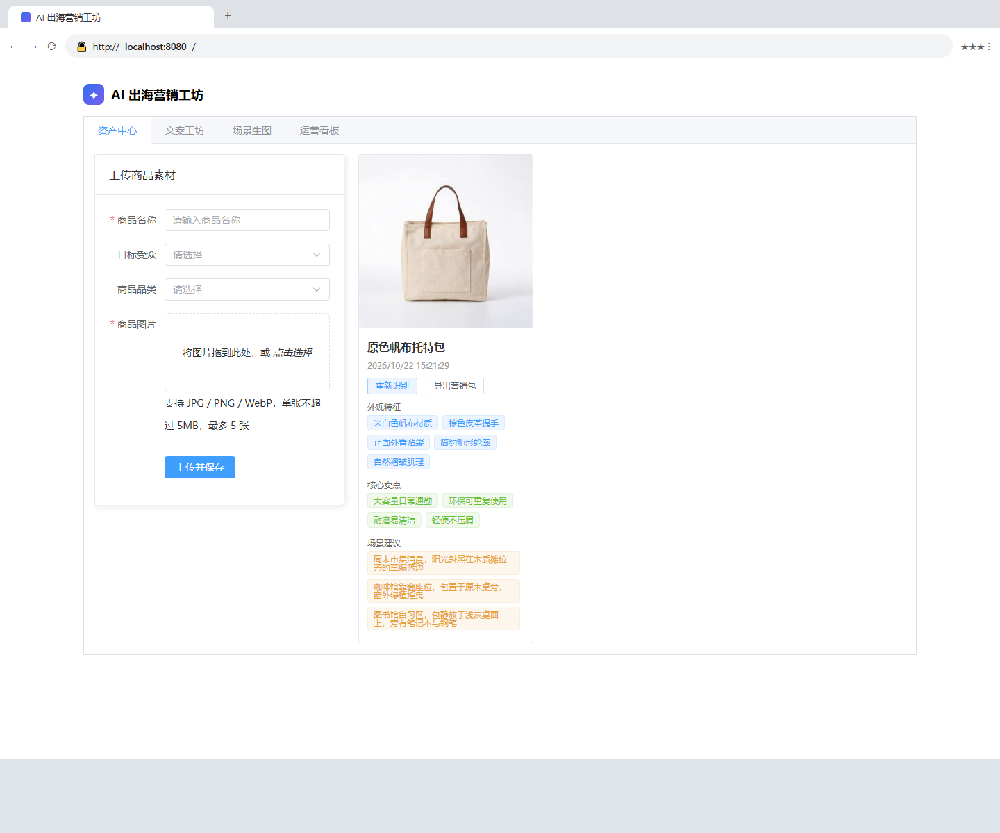
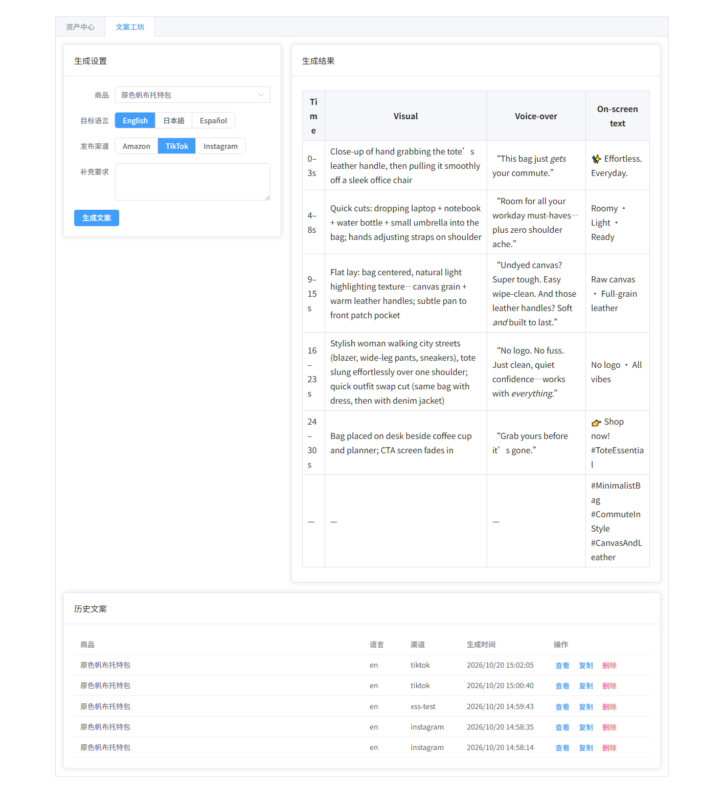
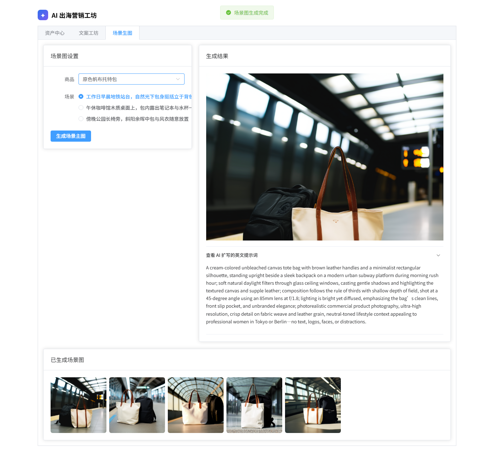
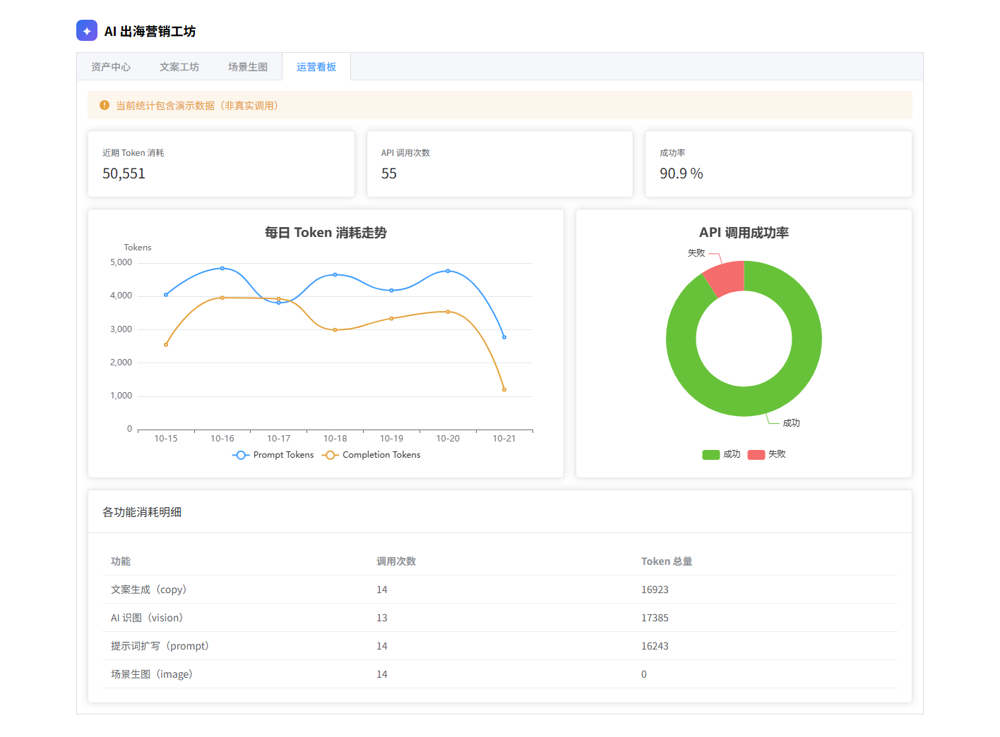

# AI 出海营销工坊

一个面向跨境电商卖家的「AI 营销素材一站式生成」全栈应用：上传商品图，AI 自动完成识图分析、多渠道多语言营销文案、商业场景主图生成，并支持一键打包导出营销素材与调用成本审计。

## 功能亮点

- **AI 一键识图**：上传商品图后自动识别外观特征、核心卖点与场景建议（qwen3-vl-plus）
- **多渠道多语言文案**：Amazon / TikTok / Instagram 三种结构化文案模板，支持英语、日语、西班牙语等，SSE 流式打字机输出
- **双层合规校验**：输入前置拦截 + 输出敏感词遮蔽，Prompt 源头约束禁止编造参数
- **AI 场景图生成**：LLM 扩写英文生图提示词 → 万相异步生图 → 结果本地化存储
- **营销包一键导出**：前端 JSZip 打包商品图、场景图、全渠道文案为 ZIP
- **Token 审计看板**：全部 AI 调用埋点，ECharts 展示 Token 消耗、成功率与失败明细
- **Docker 一键部署**：`docker compose up -d --build` 三容器编排，Nginx 反向代理 + 数据卷持久化

## 技术栈

| 层 | 技术 |
|---|---|
| 前端 | Vue 3（`<script setup>`）+ Vite + Element Plus + Pinia + ECharts + JSZip |
| 后端 | Node.js 20 + Express（ESM）+ Mongoose |
| AI | DashScope：qwen3-vl-plus（识图）/ qwen-plus（文本）/ wanx2.1-t2i-turbo（生图） |
| 部署 | Docker Compose（mongo:7 + backend + nginx:1.27-alpine） |

## 快速开始（Docker，推荐）

```bash
git clone https://github.com/Geek-ll/ai-marketing-workshop.git
cd ai-marketing-workshop

# 1. 准备环境变量：复制示例并填入 DashScope API Key
cp server/.env.example server/.env
#    编辑 server/.env，填入 DASHSCOPE_API_KEY=sk-xxxx

# 2. 一键构建并启动（首次需拉取镜像）
docker compose up -d --build

# 3. 打开 http://localhost:8080
```

> 注意：容器里的 MongoDB 是全新空库；确保 8080 端口未被占用；生图与流式生成走真实 AI 调用，会产生少量费用。

## 本地开发

```bash
# 后端（需要本机 MongoDB 或修改 MONGO_URI）
cd server
npm install
cp .env.example .env   # 填入 DASHSCOPE_API_KEY
node src/app.js        # 默认 http://localhost:3000

# 前端（另开终端）
cd client
npm install
npm run dev            # 默认 http://localhost:5173，已配置代理到 3000
```

要求 Node.js ≥ 20。

## 环境变量

| 变量 | 说明 | 示例 |
|---|---|---|
| `PORT` | 后端端口 | `3000` |
| `MONGO_URI` | MongoDB 连接串（Compose 内自动覆盖为 `mongodb://mongo:27017/aimarketing`） | `mongodb://127.0.0.1:27017/aimarketing` |
| `CORS_ORIGIN` | 允许的跨域来源，逗号分隔 | `http://localhost:5173` |
| `DASHSCOPE_API_KEY` | 阿里云百炼 API Key（**必填**） | `sk-xxxx` |
| `LLM_BASE_URL` | 文本/识图模型兼容端点 | `https://dashscope.aliyuncs.com/compatible-mode/v1` |
| `VISION_MODEL` | 识图模型 | `qwen3-vl-plus` |
| `TEXT_MODEL` | 文本模型 | `qwen-plus` |
| `IMAGE_MODEL` | 生图模型 | `wanx2.1-t2i-turbo` |
| `IMAGE_BASE_URL` | 万相原生端点（可选，有默认值） | `https://dashscope.aliyuncs.com/api/v1` |

## 接口约定

统一响应格式：`{ "code": 0, "message": "ok", "data": ... }`，非 0 为业务错误码（4001 参数错误 / 4003 不存在 / 4004 冲突 / 5001 服务器错误 / 5002 上游 AI 调用失败）。

| 方法 | 路径 | 说明 |
|---|---|---|
| GET | `/api/health` | 健康检查 |
| POST | `/api/products` | 上传商品（`images` 字段，jpeg/png/webp，单张 ≤5MB，最多 5 张） |
| GET | `/api/products` | 商品列表（分页） |
| DELETE | `/api/products/:id` | 删除商品 |
| POST | `/api/products/:id/analyze` | AI 识图并写回 `aiAnalysis` |
| POST | `/api/copy/generate` | 生成文案（非流式） |
| POST | `/api/copy/stream` | SSE 流式生成文案 |
| POST | `/api/images/generate` | 创建生图任务（返回 assetId） |
| GET | `/api/images/tasks/:assetId` | 轮询生图任务状态 |
| GET | `/api/assets` | 素材列表（支持 `type` 过滤） |
| DELETE | `/api/assets/:id` | 删除素材 |
| GET | `/api/stats/overview?days=7` | Token 统计（1–30 天） |

静态资源：`/uploads/`（上传原图与生成图）。

## 目录结构

```
ai-marketing-workshop/
├── client/                 # Vue 3 前端
│   ├── Dockerfile          # 多阶段构建：node 构建 → nginx 运行
│   ├── nginx.conf          # 反向代理 /api/、/uploads/；SSE 不缓冲
│   └── src/
│       ├── api/            # axios 接口封装
│       ├── components/     # UploadPanel / ProductList / MarkdownView
│       ├── views/          # CopyStudio / SceneStudio / Dashboard
│       └── utils/          # exportPack（JSZip 导出）/ useCopyStream（SSE）
├── server/                 # Express 后端
│   ├── Dockerfile
│   ├── .env.example        # 环境变量模板（密钥不入库）
│   └── src/
│       ├── app.js          # 入口 + 统一错误处理
│       ├── config/         # 数据库连接
│       ├── controllers/    # product / copy / image / asset / stats
│       ├── middlewares/    # multer 上传校验 / 合规拦截
│       ├── models/         # Product / MarketingAsset / TokenLog
│       ├── routes/         # 路由注册
│       ├── scripts/        # seed-token-log.js 演示数据
│       └── services/       # llmClient / visionService / imageService / usageLogger
├── docker-compose.yml      # mongo + backend + frontend
└── docs/                   # 截图
```

## 常见问题

- **流式输出一次性出现而不是逐字？** Nginx 反向代理默认会缓冲 SSE，`nginx.conf` 已对 `/api/` 设置 `proxy_buffering off`；本地开发时 Vite 代理已处理。另外响应不能开 `compression`。
- **客户端停止生成后模型还在跑？** 后端监听 `res.on('close')`，断开时同步 `AbortController.abort()` 中断上游请求，避免无效消耗。
- **生成的场景图链接会失效？** 万相结果图官方链接只保留 24 小时，后端已自动下载到 `uploads/generated/` 本地存储，数据库存的是本地路径。
- **AI 识图返回空数组？** 上传的图片需是可辨认的真实商品图；纯色块或噪点图模型无法提取特征，会返回空结果。
- **模型在文案里编造参数？** 已通过 System Prompt 事实边界约束 + 输出正则遮蔽双层防护，仍可能偶发，建议人工复核后再发布。
- **Docker 启动报 WSL2 错误？** 需先启用「适用于 Linux 的 Windows 子系统」与「虚拟机平台」，重启后执行 `wsl --update`。
- **宿主机已装 MongoDB 会不会冲突？** 不会。Compose 的 mongo 未映射宿主机端口，仅容器网络内访问。

## 截图






## License

MIT
